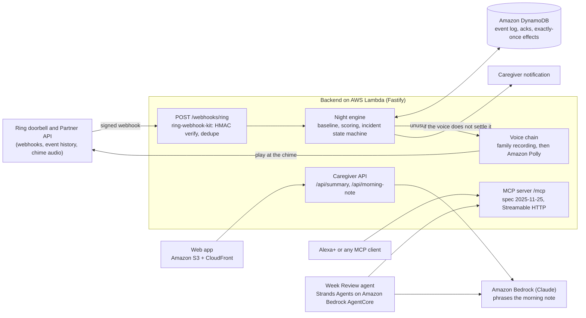

# Nightlight

The Ring doorbell works the night shift for families living with dementia: it learns the household's normal nights, answers an unusual 3am doorway with a recorded family voice, and wakes the caregiver only if that does not settle it.

- Demo video (2:58): https://youtu.be/NU24DL-NDZk
- Live site: https://d28hskpupjctiz.cloudfront.net
- Live API: https://qdvxx267lgnsitq242aplz722a0zuien.lambda-url.us-east-1.on.aws (try `/api/summary`, `/api/morning-note`, or the MCP endpoint at `/mcp`)
- Built for the Build, Ship, Shape: Amazon Developer Hackathon. Ring track, plus Alexa+, and the AWS Builder and Open Source mini challenges. First commit 2026-09-01; everything here was written during the hackathon window.

## What it does

- Takes Ring Partner API webhooks (human motion, doorbell presses, device status) at `POST /webhooks/ring`. Every delivery is HMAC SHA-256 verified and deduplicated by request id (`packages/ring-webhook-kit`, published on npm as [`ring-webhook-kit`](https://www.npmjs.com/package/ring-webhook-kit), MIT, zero dependencies).
- Learns a per-household hour-of-week baseline. New activity is absorbed slowly and new quiet quickly, so one night of wandering cannot teach the system that wandering is normal. The first 7 days are watch-only (`packages/engine/src/baseline.ts`, `WARMUP_DAYS = 7`).
- When a doorway event inside the night window (22:00 to 06:00 by default) scores as unusual, it plays the family's recorded message at the door through the Ring chime. If no recording exists, Amazon Polly speaks a fixed calm sentence instead (`apps/backend/src/voice.ts`).
- Watches for 5 minutes. If activity continues, it notifies the caregiver with a one-tap "I have it". If nobody answers within 10 minutes, it alerts backup contacts (`packages/engine/src/incidents.ts`, defaults in `packages/engine/src/types.ts`).
- Writes the caregiver a morning note. The engine computes the facts; Claude on Amazon Bedrock only phrases them, with a deterministic fallback (`apps/backend/src/summaries.ts`).
- Exposes the household to agents over an MCP server (spec 2025-11-25, Streamable HTTP) at `/mcp`, so Alexa+ or any MCP client can ask how the night went or acknowledge an incident hands-free (`apps/backend/src/mcp.ts`). An Agent Skill in `skills/nightlight/SKILL.md` tells an agent how to use it.

Detection is deterministic and explainable end to end. Language models never decide anything; they only phrase summaries.

## Why it matters

Six in ten people living with dementia will wander at least once, and night-time wandering occurs in roughly 60 percent of cases [1][2]. The published answer is detect-and-alert: a nighttime monitor that woke the caregiver reduced injuries and unattended exits [5], and its companion trial of 49 caregivers, measured by actigraphy, found their sleep did not improve on any measure [6]. That matters because 70 percent of caregivers who moved a relative into care cited nocturnal problems in that decision [4], and nearly half of dementia caregivers report trouble falling back to sleep once woken [3]. Nightlight changes what happens in the seconds after detection, so the caregiver alert becomes the escalation path rather than the first response.

## Architecture



## What is real and what is simulated

- Real: the Ring Partner API client. OAuth exchange and refresh against `oauth.ring.com`; devices, event history, snapshots and chime audio playback against `api.amazonvision.com` (`apps/backend/src/ring.ts`). Three of three read endpoints answered on 2026-09-17 with a Ring Playground token; the redacted capture is `docs/RING_LIVE.md`.
- Real: the deployed webhook route, the AWS stack (Lambda, DynamoDB, S3, CloudFront, Bedrock, Polly), the MCP server, and the Week Review agent invoked on Amazon Bedrock AgentCore.
- Real data, different population: the evaluation replays 34 real single-resident homes from the public CASAS corpus. The residents are healthy adults and the corpus contains no wandering, so it measures restraint, not wandering detection (`docs/EVAL.md`).
- Simulated: the demo household on the live site is a deterministic synthetic month (`packages/simulator`), replayed through the real signed webhook route. Every response and screen carries a Simulated label.
- Simulated: the "Ring" section of the site sends three synthetic signed deliveries to the deployed `/webhooks/ring` and shows one accepted, one tampered byte rejected with 401, and one redelivery ignored as a duplicate. They land in a sandbox household (`POST /api/ring/simulate`).
- Simulated: push, SMS and snapshot effects in the demo are journaled as "Simulated: ..." entries rather than sent (`apps/backend/src/adapters.ts`).
- Ring Playground: the demo video shows Ring's developer Playground, a sandbox doorbell reporting a simulated Motion event. The chime playback call targets Ring's audio endpoint and the whole voice chain is covered by `apps/backend/test/voice.test.ts`.
- Ring account linking (step one of connecting a real doorbell) begins in the Ring Appstore once the app is certified, so the site carries no sign-in button yet; the OAuth exchange behind it is built and tested.

## Evidence

Measured on the public CASAS HH corpus (Zenodo record 15708568, CC-BY-4.0), replayed through the production engine. Every number below is read from `apps/eval/results/casas-hh.json`, and `apps/eval/test/claims.test.ts` re-derives each one from that file and checks it appears here.

| Measure | Value | Field in `apps/eval/results/casas-hh.json` |
|---|---|---|
| Real homes | 34 | `totals.homes` |
| Nights judged | 2,936 | `totals.nightsJudged` |
| Caregiver wakes, threshold door alarm | 14,068 | `totals.thresholdAlarm.wakes` |
| Caregiver wakes, Nightlight | 774 | `totals.nightlight.caregiverWakes` |
| Wake reduction | 94.5 percent | recomputed from the two wake counts |
| Nights disturbed, alarm vs Nightlight | 1,068 vs 319 | `totals.thresholdAlarm.nightsDisturbed`, `totals.nightlight.nightsDisturbed` |
| Doorway moments settled by the voice alone | 365 | `totals.nightlight.voiceOnlyResolved` |

What the restraint cost, on the same data: of 34 resident-labeled night-time exits, Nightlight flagged 7 as unusual (`totals.labeledNightExits.nightlightNoticed`). Of the 27 it did not flag, 26 were exits the resident came back from within thirty minutes, by the corpus's own label (`totals.labeledNightExits.missedByNightlightButResidentReturnedWithin30Min`). The misses concentrate in homes where the door already opens many times a night. Method and per-home table: `docs/EVAL.md`.

Other measured figures:

- Running cost: under twenty cents per household per month, read from AWS Cost Explorer on the live deployment (`docs/EVIDENCE.md`, section 7).
- Lighthouse 13.4.1 on the deployed site: Accessibility 100, Best practices 100, SEO 100, Performance 98 (`docs/ACCESSIBILITY.md`).
- Live Ring API sweep: 3 of 3 read endpoints answered (`docs/RING_LIVE.md`).

## Research

All sources are in `docs/EVIDENCE.md`, with the corrections made during a pre-submission audit.

1. Alzheimer's Association. Wandering. https://www.alz.org/help-support/caregiving/stages-behaviors/wandering
2. Serban AI, Horrocks S, Walsh C, et al. Monitoring night-time safety in households with dementia using ambient sensing technologies. Alzheimer's & Dementia. 2025;21(Suppl 9):e110614. PMC12725205.
3. Osakwe ZT, et al. Sleep Disturbance and Strain Among Caregivers of Persons Living With Dementia. Frontiers in Aging Neuroscience. 2022;13:734382. DOI 10.3389/fnagi.2021.734382.
4. Pollak CP, Perlick D. Sleep problems and institutionalization of the elderly. Journal of Geriatric Psychiatry and Neurology. 1991;4(4):204-210. DOI 10.1177/089198879100400405.
5. Rowe MA, Kelly A, Horne C, et al. Reducing dangerous nighttime events in persons with dementia by using a nighttime monitoring system. Alzheimer's & Dementia. 2009;5(5):419-426. PMID 19751921.
6. Rowe MA, et al. Sleep in Dementia Caregivers and the Effect of a Nighttime Monitoring System. Journal of Nursing Scholarship. 2010;42(3):338-347. DOI 10.1111/j.1547-5069.2010.01337.x.
7. Mattos MK, Bernacchi V, Shaffer KM, et al. Sleep and Caregiver Burden Among Caregivers of Persons Living With Dementia: A Scoping Review. Innovation in Aging. 2024;8(2):igae005.
8. Mittelman MS, Ferris SH, Shulman E, Steinberg G, Levin B. A family intervention to delay nursing home placement of patients with Alzheimer's disease. JAMA. 1996;276(21):1725-1731. PMID 8940320.
9. Rowe MA, Bennett V. A look at deaths occurring in persons with dementia lost in the community. American Journal of Alzheimer's Disease and Other Dementias. 2003;18(6):343-348. PMC10833970.
10. Alzheimer's Association. 2026 Alzheimer's Disease Facts and Figures. Alzheimer's & Dementia. 2026. DOI 10.1002/alz.71345.
11. Cook D, et al. CASAS smart home datasets, Washington State University. Zenodo record 15708568, CC-BY-4.0.

## Run it

Node 20 or newer.

```
npm install
npm test          # builds the packages, then runs every vitest suite
npm run demo      # replays the simulated month through the engine and prints the nights
npm run dev       # backend plus MCP server on http://127.0.0.1:8787
npm run web:dev   # the site, against the backend
```

Try the local API:

```
curl -X POST http://127.0.0.1:8787/api/demo/replay -H "content-type: application/json" -d "{}"
curl http://127.0.0.1:8787/api/summary
curl http://127.0.0.1:8787/api/morning-note
```

A household of your own on the live API, no account needed. Nothing about the key is stored; the household is derived from the key's hash on every request (`apps/backend/src/keys.ts`).

```
API=https://qdvxx267lgnsitq242aplz722a0zuien.lambda-url.us-east-1.on.aws
curl -X POST $API/v1/keys
curl -X POST $API/api/demo/replay -H "authorization: Bearer <key>"
curl $API/api/summary -H "authorization: Bearer <key>"
```

Talk to it over MCP (Streamable HTTP):

```
curl -i -X POST http://127.0.0.1:8787/mcp \
  -H "content-type: application/json" \
  -H "accept: application/json, text/event-stream" \
  -d '{"jsonrpc":"2.0","id":1,"method":"initialize","params":{"protocolVersion":"2025-11-25","capabilities":{},"clientInfo":{"name":"curl","version":"0"}}}'
# take the MCP-Session-Id response header, then:
curl -X POST http://127.0.0.1:8787/mcp \
  -H "content-type: application/json" \
  -H "mcp-session-id: <SESSION-ID>" \
  -d '{"jsonrpc":"2.0","id":2,"method":"tools/call","params":{"name":"get_night_summary","arguments":{"date":"2026-09-23"}}}'
```

Probe the deployed MCP server over real HTTP, no install: `npm run verify:live` (`scripts/mcp-conform.mjs`, nineteen graded checks against spec revision 2025-11-25).

The Week Review agent (Strands Agents, Claude on Amazon Bedrock, needs AWS credentials):

```
pip install strands-agents strands-agents-tools
python apps/agent/week_review.py --url https://qdvxx267lgnsitq242aplz722a0zuien.lambda-url.us-east-1.on.aws/mcp
```

Deploy your own stack: `docs/AWS.md` (CDK, `infra/`). Deploy the agent to Amazon Bedrock AgentCore: `apps/agentcore/README.md`.

Reproduce the Ring API evidence with a thirty-minute token from the Ring console Playground (never commit the value): `RING_ACCESS_TOKEN="<token>" npx tsx apps/backend/scripts/ring-evidence.mts`.

## Tests

Run on 2026-10-22, both suites passing.

| Command | Where | Result |
|---|---|---|
| `npx vitest run` | repository root (same as `npm test`) | 23 files, 163 tests passed |
| `npx jest` | `apps/agentcore/agentcore/cdk` (after `npm install` there) | 1 test passed |

So the repository carries 163 tests total in the vitest suite, across `packages/engine`, `packages/ring-webhook-kit`, `packages/simulator`, `apps/backend`, `apps/web` and `apps/eval`, plus the CDK synthesis test. The Python agent code in `apps/agent` and `apps/agentcore/app` has no test suite; it is verified by invoking it against the live MCP server (`apps/agentcore/README.md`).

Tests that pin public claims: `apps/eval/test/claims.test.ts` re-derives every evaluation figure from `apps/eval/results/casas-hh.json`; `apps/eval/test/counts.test.ts` checks that stated test counts match the suite; `apps/eval/test/skill.test.ts` checks the Agent Skill names every MCP tool; `apps/backend/test/mcp.test.ts` holds 20 MCP transport tests; `apps/backend/test/ring-simulate.test.ts` checks the published household is untouched by the site's Ring proof.

## AWS and tools used

| Tool | What it does here | Where |
|---|---|---|
| Ring Partner API | signed webhook intake, OAuth token exchange, devices, event history, snapshots, chime audio | `apps/backend/src/ring.ts`, `apps/backend/src/server.ts`, `packages/ring-webhook-kit` |
| Alexa+ via MCP (spec 2025-11-25, Streamable HTTP) | five household tools, signed sessions, origin allowlist | `apps/backend/src/mcp.ts` |
| Agent Skill | tells an agent how to use the five tools and what never to say | `skills/nightlight/SKILL.md` |
| Amazon Bedrock (Claude) | phrases the morning note; three-model ladder with deterministic fallback | `apps/backend/src/summaries.ts` |
| Strands Agents | the Week Review agent, an outside client of the MCP server | `apps/agent/week_review.py` |
| Amazon Bedrock AgentCore | hosts the same agent as an invocable runtime, `nightlightweek_weekreview`, us-east-1 | `apps/agentcore/` |
| Amazon Polly | the synthesised voice when no family recording exists | `apps/backend/src/voice.ts` |
| Amazon DynamoDB | event log, acks, exactly-once effect claims by conditional put | `apps/backend/src/store.ts` |
| AWS Lambda, Amazon S3, Amazon CloudFront, AWS CDK | the backend, the site, one deploy | `infra/bin/app.ts`, `apps/backend/src/lambda.ts` |

Reasons for each choice, and the services deliberately not used, are in `docs/AWS.md`. Product feedback on every tool is in `PRODUCT_FEEDBACK.md`; `FRICTION_LOG.md` has eight entries.

## Privacy

- Stored, per household, in one DynamoDB table (`apps/backend/src/store.ts`): Ring events (timestamp, event type, device id, request id, motion sub-type), caregiver acknowledgements, a record of each effect already executed, and small metadata rows for Ring tokens and link state.
- Stored in S3: one Polly clip per device at a fixed key, overwritten rather than accumulated (`apps/backend/src/voice.ts`).
- Thrown away: webhook payloads beyond the fields above, API keys (never stored; the household is derived from the key's hash, `apps/backend/src/keys.ts`), and MCP sessions, which are signed tokens rather than stored rows (`apps/backend/src/mcp.ts`).
- Never stored: video. Doorway snapshots are fetched on demand from Ring and in the demo are only journaled as a simulated request.
- The engine never diagnoses. It reports what happened at the door, and the Agent Skill forbids medical or care advice.
- Secrets live in `.env` files that are gitignored. `docs/RING_LIVE.md` was redacted by the capture script before it was written.

Nightlight is a home safety aid. It does not diagnose, treat or prevent any medical condition, and it does not replace supervision or professional care advice. In an emergency, call your local emergency number.

## Documentation

[EVIDENCE.md](docs/EVIDENCE.md) · [EVAL.md](docs/EVAL.md) · [AWS.md](docs/AWS.md) · [RING_LIVE.md](docs/RING_LIVE.md) · [DESIGN.md](docs/DESIGN.md) · [ACCESSIBILITY.md](docs/ACCESSIBILITY.md) · [FEATURE_REQUESTS.md](docs/FEATURE_REQUESTS.md) · [VIDEO_SCRIPT.md](docs/VIDEO_SCRIPT.md) · [FRICTION_LOG.md](FRICTION_LOG.md) · [PRODUCT_FEEDBACK.md](PRODUCT_FEEDBACK.md)

## Licence

MIT. See [LICENSE](LICENSE). `ring-webhook-kit` is also MIT.
